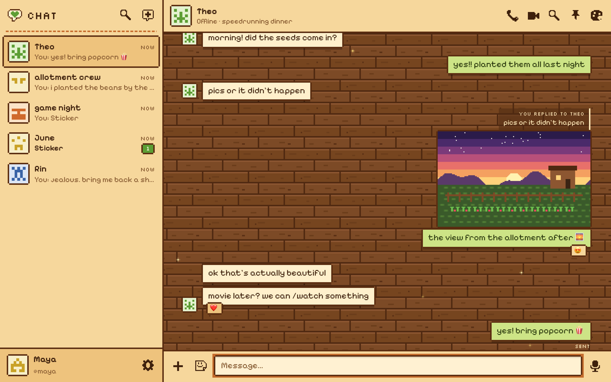
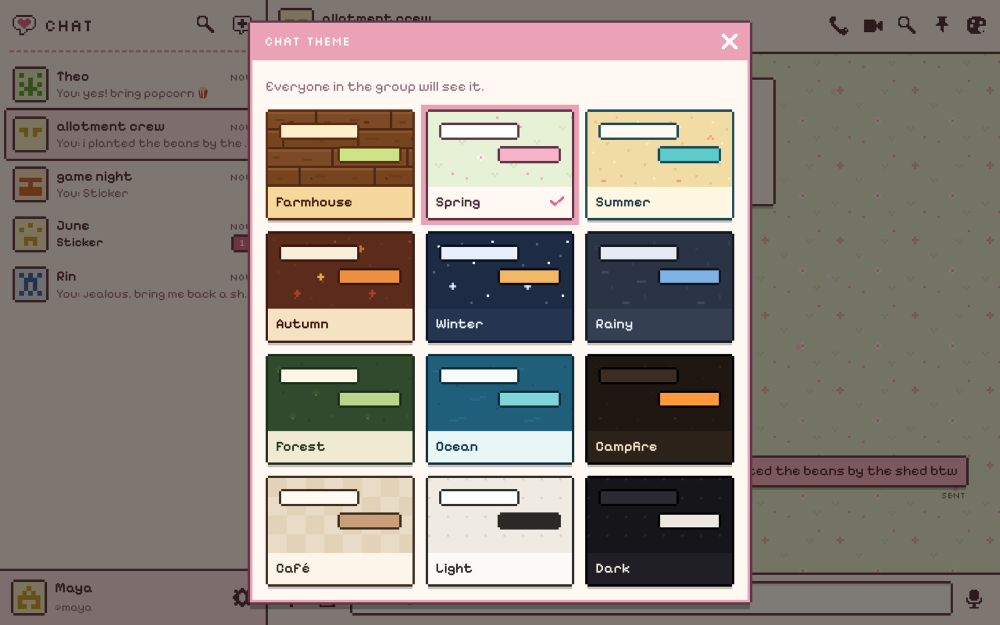
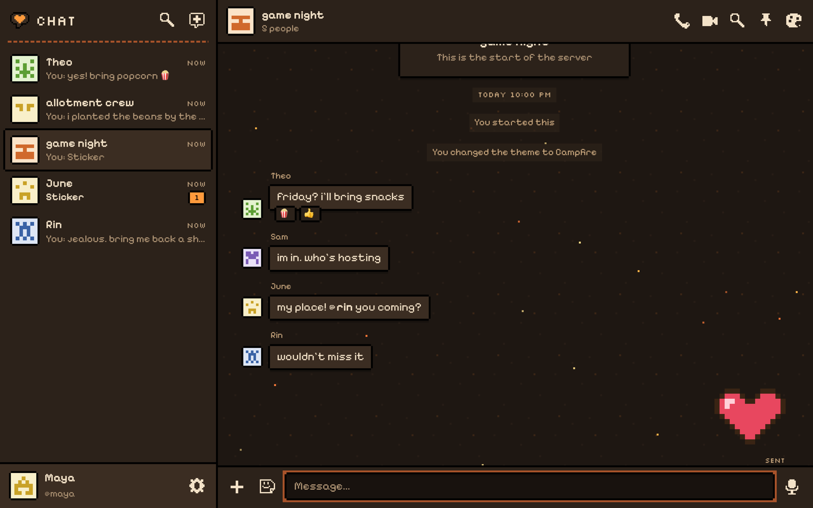
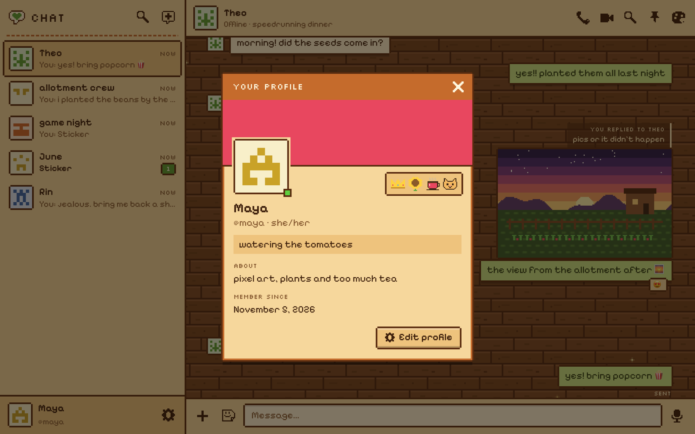
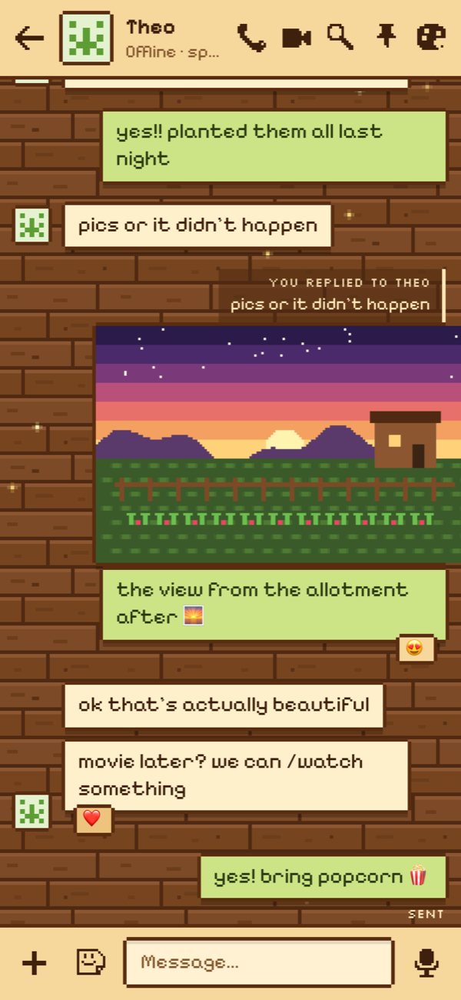

# cozy pixel chat

A small, private, invite-only chat app in a pixel-art style. One-to-one chats,
small groups and "servers", with chat themes like Instagram has: anyone in a
chat can pick its theme, and everyone in that chat sees the change.

No build step, no framework, and only two npm dependencies (`ws` and
`busboy`). Data lives in SQLite through Node's built-in `node:sqlite`, so
there's nothing to compile either.



<table>
  <tr>
    <td width="50%"></td>
    <td width="50%"></td>
  </tr>
  <tr>
    <td width="50%"></td>
    <td width="50%" align="center"></td>
  </tr>
</table>

<sub>Everyone in the screenshots is made up.</sub>

## Quick start (Docker)

```sh
git clone https://github.com/SnakeLuck360GT/cozy-pixel-chat.git
cd cozy-pixel-chat
docker compose up -d
docker compose exec app chat-admin add-user yourname --owner
```

Open <http://localhost> and log in with the password it printed. Invite
people from the admin page (`/admin`).

That runs two containers: the Node server, and Caddy in front of it serving
the pages. Locally the app is on `http://localhost` and attachments come from
`http://127.0.0.1`, which the browser treats as a different site (see
[below](#how-members-only-works) for why that matters).

### On a real server

1. Point two subdomains at the server, e.g. `chat.example.com` and
   `chat-files.example.com`.
2. `cp .env.example .env` and put them in `PUBLIC_URL` and `CONTENT_URL`.
3. `docker compose up -d`. Caddy gets the HTTPS certificates by itself.
4. Make your account: `docker compose exec app chat-admin add-user yourname --owner`

Calls work without anything else when both people can connect directly. For
everyone else (phones on mobile data, mostly) you want the relay: fill in
the TURN lines in `.env`, open the ports listed in [Calls](#calls-and-the-turn-relay),
and run `docker compose --profile calls up -d`.

Everything (database, uploads, the signing secret) is in the `chat-data`
volume. To update: `git pull && docker compose up -d --build`.

## How it's built

- **Backend:** one Node.js process (`server.js` + `lib/`) with no web
  framework, just `node:http`. It handles the REST API, uploads (streamed
  with busboy) and a WebSocket hub for everything live: new messages, typing,
  presence, read receipts, and call signalling.
- **Database:** SQLite via `node:sqlite`, in WAL mode.
- **Frontend:** plain ES modules, no bundler, no framework. A tiny `h()`
  helper builds the DOM. Every icon is a 12×12 pixel grid in code, the
  stickers are drawn from strings of letters, and the theme backgrounds are
  hand-made SVG tiles.
- **Calls:** WebRTC in a mesh (up to 6 people), with the server only passing
  the offers and answers along. coturn relays when a direct connection fails,
  using short-lived HMAC logins so no TURN passwords are stored anywhere.
- **Security:** attachments live on a separate origin with no cookies and
  HMAC-signed, expiring links. File types are sniffed from their bytes.
  Strict CSP. scrypt password hashes. Login rate limiting. Origin checks on
  every write and on the WebSocket.

## What it does

- Messages update live, with replies, reactions (double-tap or double-click
  to heart), editing, unsending, links, @mentions, typing dots, "Seen",
  unread counts, online status, pinned messages and search.
- Photos, videos, files, voice notes and stickers (including custom ones).
  Photos are shrunk before upload, and JPEGs are redrawn, which strips their
  location data.
- Calls that work like Discord's: any chat (one-to-one or a group of up to 6)
  can have a call going. Starting one rings everyone else, and anyone in the
  chat can join, leave and rejoin while it's open. Screen sharing on
  computers, per-person volume with boost, and a green edge on whoever's
  talking.
- Watch together: `/watch <YouTube link>` puts a video on for everyone in the
  chat, with play, pause and skipping kept in step. `/watch stop` ends it. It
  uses the youtube-nocookie.com embed, so no YouTube scripts run in the app
  itself.
- Twelve themes (Farmhouse, Spring, Summer, Autumn, Winter, Rainy, Forest,
  Ocean, Campfire, Café, Light and Dark), most with a bit of weather drifting
  across them. Everyone also picks their own theme for the home screen, and
  can choose pixel or smooth text.
- Profiles with a picture (animated GIFs keep moving), a banner and badges.
  Anyone without a picture gets a pixel pattern made from their username.

## How "members only" works

The app runs on one origin (say `chat.example.com`) and attachments on
another (`chat-files.example.com`), so an uploaded file can never touch
anyone's login. The file origin has no cookies. Instead, the app hands out
links signed with an HMAC that expire after about a day, and the server
checks the signature before serving anything. The type of each file is
decided from its first bytes when it's uploaded. Only plain pictures, video
and audio open in the browser; everything else (SVG, PDF, HTML…) downloads.

## Roles

- **Owner**: everything admins can do, plus resetting passwords, changing
  roles, deleting accounts, and seeing the IP address each file was uploaded
  from.
- **Admins**: the admin page's overview, invite codes, adding accounts, and
  the max file size.
- **Everyone**: chat. Whoever makes a group can remove people from it, and
  anyone in a group can rename it, add people or leave.

New accounts come from invite codes (`/signup?code=…`) or the admin page.
Everyone except the owner has to accept the terms (`public/terms.html`)
before sending anything. The version, time and IP are recorded. Bump
`TERMS_VERSION` in `server.js` to make people accept again after a change.

> The terms page is a template. Change the contact email and check the
> governing law before you invite anyone.

## Running it on a server (no Docker)

`deploy/setup.sh` sets everything up on an Ubuntu box: Node, Caddy (which
handles HTTPS), coturn for calls, a systemd service and a `chat-admin`
command. It's happy sharing a server with other sites, since it writes its
own file to `/etc/caddy/sites/`.

1. Point two subdomains at the server, for example `chat` and `chat-files`.
2. Copy the code over:

   ```sh
   rsync -az --delete --exclude node_modules --exclude data --exclude .git ./ you@SERVER_IP:chat/
   ```

3. Run the setup script there:

   ```sh
   ssh you@SERVER_IP 'cd chat && sudo DOMAIN=chat.example.com CONTENT_DOMAIN=chat-files.example.com ADMIN=yourname bash deploy/setup.sh'
   ```

   It makes the owner account (and prints its password), generates the
   secrets, starts the service on port 3002, sets up coturn, and gets HTTPS
   certificates for both subdomains.

To update later, rsync again and rerun the script without `ADMIN`.

- Logs: `journalctl -u chat -f` (the call relay: `journalctl -u coturn`)
- Locked out? `sudo chat-admin reset-password yourname`
- Accounts from SSH: `sudo chat-admin add-user name [--admin]`, `delete-user name`, `list`
- Settings are in `/etc/chat.env`. Data is in `/var/lib/chat`: `chat.db`
  (back it up with `sqlite3 chat.db ".backup copy.db"`) and `files/`.

## Calls and the TURN relay

Audio and video go straight between devices when they can reach each other.
When they can't (pretty common on mobile data) they go through coturn, a
TURN relay. The chat server hands out short-lived relay logins made with a
secret it shares with coturn. For the relay to work, open **UDP 3478, TCP
3478 and UDP 49160-49200** in your cloud provider's firewall as well as on
the machine.

## Running it locally

You need Node 22.13 or newer.

```sh
npm install
node --disable-warning=ExperimentalWarning manage.js add-user me --owner
PUBLIC_URL=http://localhost:8080 CONTENT_URL=http://localhost:8081 npm start
node dev/proxy.js     # in another terminal, then open http://localhost:8080
```

`dev/proxy.js` stands in for Caddy: it serves `public/` on :8080 and the file
origin on :8081.

## Layout

- `server.js` with `lib/`: the API, live updates over a WebSocket (`/ws`),
  uploads, and the attachment server for the file origin.
  - `lib/live.js`: the WebSocket hub (sign-in by cookie, Origin check).
  - `lib/calls.js`: call rooms: ringing, who's in each call, and passing
    connection details between people.
  - `lib/db.js`: the schema.
- `public/`: the app (`index.html` and `js/`), plus Log in, Sign up, Terms and
  Admin. Plain ES modules. Themes are CSS custom properties in `style.css`
  with background tiles in `public/themes/`. Icons are 12×12 pixel grids in
  `js/icons.js`.
- `manage.js`: command-line account tool.
- `deploy/`: the Caddy config, the systemd service and the setup script.
- `dev/proxy.js`: a stand-in for Caddy when running locally.

## License

MIT, see [LICENSE](LICENSE). The bundled fonts (Silkscreen and Pixelify
Sans) are under the SIL Open Font License; their licenses are in
`public/vendor/`.
