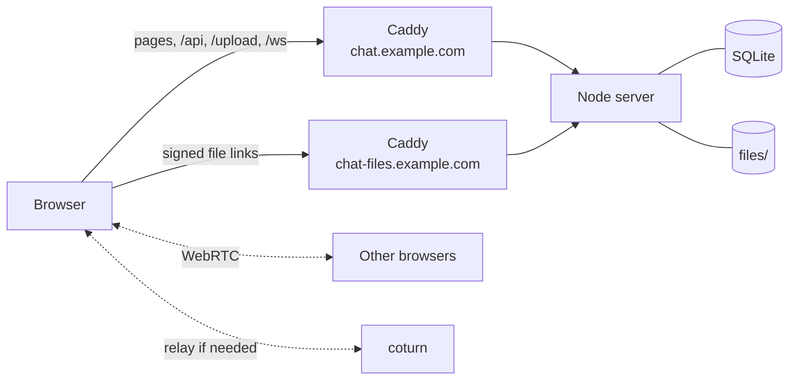
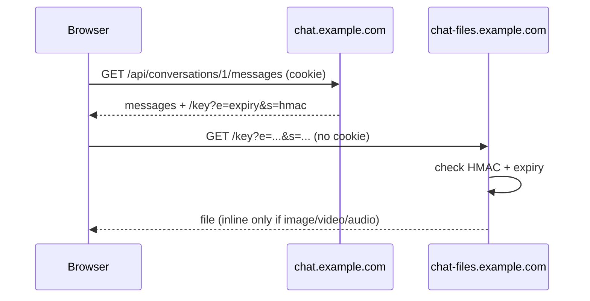
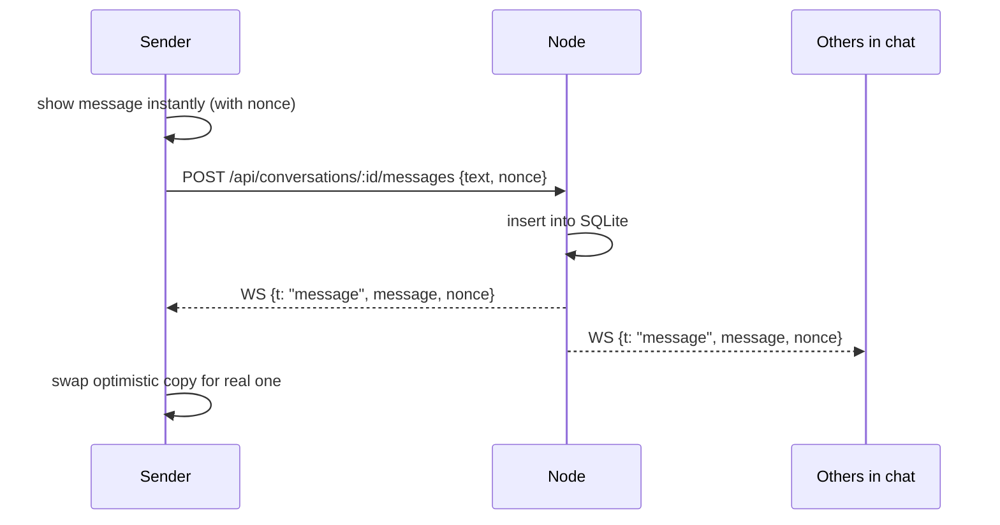
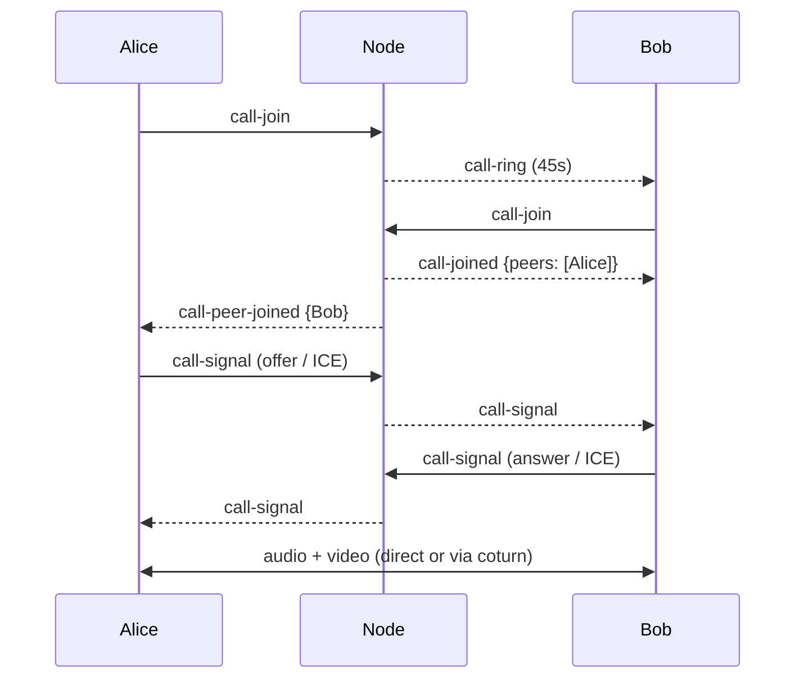
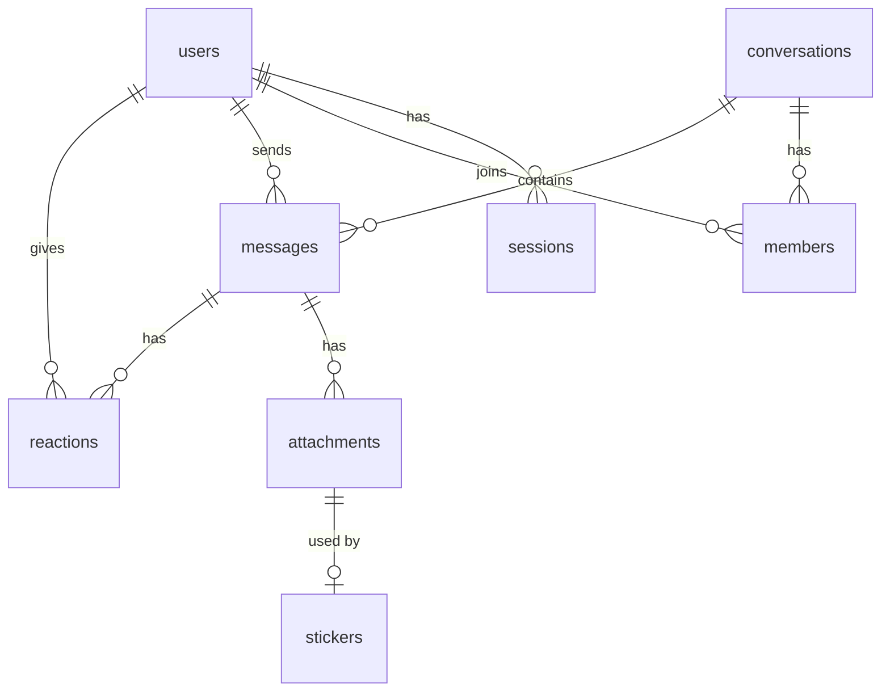

## Overview

- One Node process: API, uploads, WebSocket hub, attachment server
- Caddy: HTTPS, static pages, reverse proxy
- No framework on either side: `node:http` + plain ES modules

## Attachments on a second origin

- Uploaded files can never run as the app or read the session cookie
- Links are HMAC-signed and expire after ~24h (rounded to the hour for caching)
- File type is sniffed from the first bytes, not the name or browser's claim
- Anything that isn't plain image/video/audio is forced to download

## Messages

- One WebSocket per tab, authenticated by the session cookie
- Origin is checked on upgrade (other sites can open sockets with your cookies)
- Pushes: messages, edits, reactions, typing, read markers, presence, theme changes

## Calls

- One call per chat, up to 6 people, kept in memory (`lib/calls.js`)
- Full mesh: one `RTCPeerConnection` per pair, "perfect negotiation" for mid-call changes
- Server only relays signalling, media never touches it
- Ends when everyone leaves, or after someone is alone for 3 minutes
- TURN logins are short-lived HMACs of a secret shared with coturn

## Watch together

- `/watch <link>` stores video, position and play state per chat (in memory)
- Changes are broadcast over the WebSocket
- Clients use the server's clock to agree on the current position
- youtube-nocookie.com embed, controlled with `postMessage` (no YouTube JS in the app)

## Data

- SQLite via `node:sqlite` (WAL mode), nothing to compile
- Conversations are `dm`, `group` or `server`
- Attachments are uploaded first and linked to a message on send
- Hourly sweep: unsent uploads older than a day, expired sessions, old invites

## Security

- Passwords: scrypt
- Session tokens and invite codes stored only as hashes
- `__Host-` cookie over HTTPS (files subdomain can't set or overwrite it)
- Login rate limiting per IP; unknown usernames take as long as wrong passwords
- API writes require JSON and a matching Origin
- Strict CSP, `frame-ancestors 'none'`
- Photos are resized client-side; redrawing JPEGs strips EXIF/GPS

## Frontend

- Plain ES modules, no bundler
- Tiny `h()` helper for building DOM
- Icons are 12×12 pixel grids in code, stickers are drawn from strings
- Themes are CSS variables + a small SVG tile
