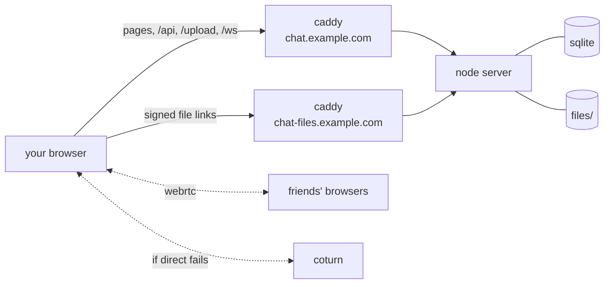

<i>a little peek at how the garden grows 🌿</i>

## 🌳 the big picture

one node process does everything: the api, uploads, live updates and handing
out attachments. caddy sits in front to do https and serve the pages. no
frameworks anywhere, just node's own `http` module and plain js in the browser.

## 🏡 two little houses

the app and the attachments live on different subdomains. that way an
uploaded file, even a sneaky html or svg one, can never pretend to be the app
or peek at anyone's login.

the files house has no cookies, so it can't tell who's knocking. instead the
app hands out links like `/<key>?e=<expiry>&s=<hmac>`, and the server checks
the signature and the expiry before letting anything out. links last about a
day, and the expiry is rounded to the hour so browsers can cache them.

file types come from the first few bytes of the file, never its name or what
the browser claims. only plain pictures, video and audio open in the browser.
everything else just downloads.

## ✨ live updates

every open tab keeps one websocket (`lib/live.js`). it logs in with the
session cookie and has to come from the app's own origin, because other
sites can open sockets with your cookies attached.

the server sends new messages, edits, reactions, typing dots, read markers,
who's online and theme changes to everyone in that chat. each message you
send carries a `nonce`, so the copy that appears instantly gets swapped for
the real one when it lands.

## ☎️ calls

each chat can have one call, kept as a little room in memory
(`lib/calls.js`). starting one rings everyone else for 45 seconds. anyone can
hop in, leave and come back, up to 6 people. if someone sits alone for 3
minutes the call ends by itself.

your voice and video never touch the server. every pair of people gets their
own `RTCPeerConnection`, using the "perfect negotiation" pattern so either
side can change things mid-call (like turning a camera on). the server just
passes the offers, answers and ICE candidates along the websocket.

when two people can't reach each other directly (hi, mobile data), coturn
relays the call. the server gives out TURN logins that expire, made with an
HMAC of a secret it shares with coturn, so no TURN passwords are stored.

## 🍿 watching together

`/watch <link>` keeps the video, its position and whether it's playing in
memory for that chat, and tells everyone when it changes. each person's app
works out where the video should be using the server's clock, so you all stay
in step. the player is the youtube-nocookie.com embed, steered with
`postMessage`, so youtube's scripts never run inside the app.

## 📷 uploads

photos get shrunk on a canvas in the browser before they're sent, and
redrawing jpegs strips out their location data too. uploads stream to disk
through busboy with a size limit and get a random 16-character name.

once an hour, a little sweep tidies up: files that were uploaded but never
sent (after a day), expired sessions and old invites. 🧹

## 🪴 data

sqlite through `node:sqlite` in WAL mode, so there's nothing to compile. the
tables are `users`, `sessions`, `invites`, `conversations`, `members`,
`messages`, `attachments`, `reactions`, `stickers` and `settings`.

## 🔒 keeping it safe

- passwords are hashed with scrypt
- session tokens and invite codes are only stored as hashes
- over https the cookie is `__Host-` prefixed, so the files subdomain can't
  set it or swap it out
- failed logins are rate limited per ip, and a wrong username takes as long as
  a wrong password, so timing can't tell anyone which usernames exist
- api writes only accept json, and check where the request came from

## 🎨 the pretty bits

plain es modules, served as they are, with no bundler. a tiny `h()` helper
builds the page. every icon is a 12×12 pixel grid written in code, the
stickers are drawn from strings of letters, and each theme is a handful of
css colours plus a tiny svg tile 🌸
